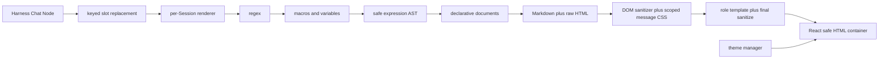

# DeepSeek Harness Tavern Renderer Design

## 1. Package layout

```text
dsh-tavern-renderer/
├── index.js                    # empty Node half for Harness Loader discovery
├── cordis.patch.yml            # bundle layer that inserts the client package row
├── src/
│   ├── client/
│   │   ├── index.jsx           # Cordis apply(), slot registrations, public browser API
│   │   ├── renderers.jsx       # assistant/user/steering React adapters
│   │   └── plugin.css          # scoped component and built-in theme styles
│   └── core/
│       ├── pipeline.js         # ordered, pluggable, switchable stage runner
│       ├── regex.js            # compact/ST-shaped regex rule parser and executor
│       ├── macros.js           # registry, built-ins, variables, bounded nesting
│       ├── expression.js       # restricted tokenizer/parser/evaluator
│       ├── documents.js        # declarative document parser and eight safe templates
│       ├── markdown.js         # dependency-free Markdown to HTML
│       ├── sanitize.js         # DOM allowlist and scoped CSS sanitizer
│       ├── templates.js        # role wrappers
│       ├── themes.js           # theme/custom-CSS lifecycle
│       └── index.js            # core public API
├── scripts/build.mjs           # reproducible client bundle wrapper build
├── tests/*.spec.js             # minimum sample plus adversarial security tests
├── SPEC.md
├── DESIGN.md
├── SOURCES.md                  # consulted sources, licenses, and reuse statement
├── QUALITY-REVIEW.md           # three explicit review/improvement passes
└── README.md
```

`lib/client.js` is generated and shipped. It registers a lazy CJS factory through Harness's `window.__ModuleLoader__`; React and Harness platform modules remain external and resolve from the Web module table. Core code has no runtime package dependencies.

## 2. Data flow and ordering



Every text stage receives a string and immutable render metadata and returns a string. `registerStage({ name, before/after, run })` inserts an extension; `setStageEnabled(name, boolean)` switches any stage. A trace in every render result records the executed order and supports diagnostics/tests.

Regex replacement macros use the same macro registry and variable map as the later full macro pass. This is required for capture-dependent `setvar` and `{{char}}` substitutions. Rendering errors are isolated to their stage and produce inert visible text; they do not abort the conversation renderer.

The document stage parses only fixed `:::type` directives. It renders body Markdown early, replaces each complete document with a private-use sentinel, and lets the normal Markdown stage process surrounding prose before restoring generated HTML. This avoids invalid nested paragraph wrappers while preserving one final sanitizer boundary. Field values are escaped; only internal type/variant tables can select CSS classes.

## 3. Harness coupling

No Harness source file or dependency manifest is changed.

The existing client slot `conversation.chat.node` is declared by `ui-chat`. Built-in renderers register keys `assistant-step`, `user`, and `steering` at default priority 0 in `register-node-renderers.ts`. The slot contract states that lower priority wins. This plugin registers the same keys at priority `-100` through `ctx.slots.inject(...)`, so it shadows rather than mutates/removes the built-ins. Disposing the plugin removes its registrations and automatically reveals the built-ins again.

The bundle's `cordis.patch.yml` inserts one Loader row naming this package. Its empty Node `apply()` lets `dsh-client-modules` discover `dsh.client` and serve `lib/client.js`. Installation uses the supported command:

```powershell
dsh plugin --profile web add .
```

The adapter renders image groups through the public `conversation.images.content` Factory with the owner-provided authorized `loadImage`, and unknown JSON blocks through platform primitives. It does not redeclare the native assistant's image child slot: declarations remain owned by their original registrations even while shadowed, and duplicate declarations throw. It uses the `chat` locale namespace and explicitly injects `@deepseek-ai/dsh-client-ui-chat` plus `@deepseek-ai/dsh-client-ui-attachment`, the image Factory provider. Assistant tool-call heads remain omitted because Harness groups tool rows separately. `groupPart` selects reasoning or response without duplication, and completed inline reasoning follows its enclosing turn's fold state. User/steering text retains ordered image/file attachments, reference labels, and copy actions.

Assistant nodes receive Harness's `status === 'running'` as render context. Harness already replaces the partial node on every stream frame, so React's existing memo boundaries remain valid. The plugin uses the flag only to render an unfinished known document as a live draft; no timers, observers, or Harness core patches are introduced.

## 4. State and configuration

One renderer/variable map is created per Harness Session ID in the client apply closure. There are no module-level Session stores. Plugin disposal clears all maps, style nodes, global API, and event listeners.

The browser API is exposed as `window.DeepSeekTavernRenderer`:

- `configure(partial)` updates identity, regex, stage, template, and expression settings;
- `render(text, context)` offers a test/extension entry point;
- `setTheme(name)`, `setCustomCss(css)`, `getConfig()` manage appearance;
- `registerMacro`, `unregisterMacro`, `registerStage`, `setStageEnabled` extend the pipeline.

Theme name, serializable renderer configuration, and safe custom CSS persist in `localStorage`. Custom CSS is user-authored appearance configuration but is still stripped of imports/URLs/dynamic declarations and scoped under `[data-dsh-tavern-renderer]`. Message HTML is always untrusted, and role templates receive a final allowlist pass after wrapping.

## 5. Security decisions

### ADR-001: no arbitrary JavaScript

**Decision:** parse the documented expression subset into an AST and evaluate values directly.

**Reason:** arbitrary browser evaluation would expose cookies/storage, Cordis services, DOM mutation, network requests, and prototype/constructor escape paths. It is also not supported by the locked SillyTavern message source.

### ADR-002: structured HTML sanitization

**Decision:** use `DOMParser` and node/attribute allowlists; regex is used only inside the constrained CSS grammar.

**Reason:** HTML cannot be safely sanitized by replacement patterns. Dangerous elements are dropped with their contents; harmless unknown wrappers are unwrapped.

### ADR-003: slot shadowing instead of core patches

**Decision:** register keyed renderers at priority `-100`.

**Reason:** this is the Harness-owned extension mechanism, is reversible on disposal, and avoids a source fork. Priority is deliberately not the minimum integer so deployments retain room for an explicit higher-precedence override.

## 6. Requirement mapping

| Requirement | Implementation |
|---|---|
| 1. Pipeline | `pipeline.js`: `RenderPipeline`, `TavernRenderer` |
| 2. Regex | `regex.js`: `parseRegexRule`, `applyRegexRules` |
| 3. Macros/variables | `macros.js`: `MacroRegistry`, `MacroEngine` |
| 4. Inline expression | `expression.js`: tokenizer, Pratt parser, evaluator |
| 5. Markdown | `markdown.js`: block and inline renderers |
| 6. Safe HTML | `sanitize.js`: allowlists and DOM tree rewrite |
| 7. CSS/themes | `themes.js`, `plugin.css`: `ThemeManager` |
| 8. Role templates | `templates.js`: `applyRoleTemplate` |
| 9. Character context | `pipeline.js` context normalization; per-Session adapter injection |
| Immersive documents | `documents.js`, `plugin.css`: fixed directive parser and eight templates |

## 7. Failure and performance boundaries

- Input defaults to 1 MiB maximum per message; expressions default to 512 characters and 256 tokens.
- Macro expansion is bounded to 20 passes; stage count and expression operations are bounded.
- Invalid regex rules are skipped with trace diagnostics. Regexes are trusted configuration; JavaScript offers no portable preemptive timeout, so pattern length and obvious nested-quantifier shapes are rejected but cannot prove linear runtime.
- Invalid or malicious HTML/CSS is removed, never repaired into executable markup.
- Streaming messages re-run pure transforms; variable writes are deterministic assignments. Expensive syntax highlighting and arbitrary script execution are absent.
- Document directives are limited to 32 metadata fields; incomplete directives render as documents only while their Harness node is running.

## 8. Host version boundary

The current adapter targets npm DSH 0.2.1-rc.2 and 0.2.1-rc.3. Its `engines.dsh` range is `>=0.2.1-rc.2 <0.3.0-0`; optional peer ranges also accept both tested releases. Desktop shares the Web client module table and `platform: "web"`, runs under `dsh-app://app/`, and uses its own `desktop` profile. Installation into that profile uses the Desktop-bundled CLI while the app is closed. Text/code fonts and content sizes use host CSS variables. Web launch-token authentication, V4 Session log replay, Profile plugin settings, preset plugin bundles, and Remote transport stay in the host. Renderer preferences remain local to each client's origin; no settings card or ApiProxy endpoint needs migration. The renderer never treats display nodes as the RP settlement or canonical state surface, and does not call deprecated `snapshotEvents`, `eventAt`, or `ownEvents` APIs.
